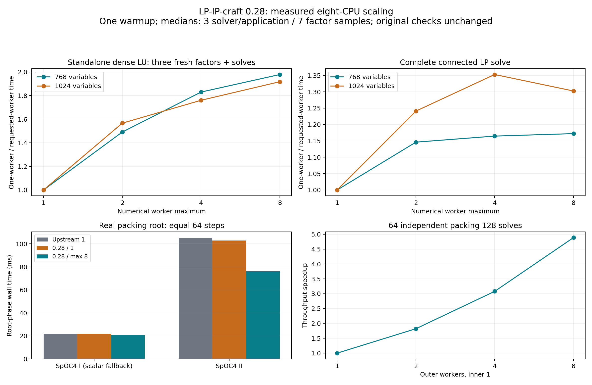

# LP-IP-craft 0.28.0: 30 eight-worker performance iterations

Implemented a new 30-checkpoint series on the requested current upstream, `a1180e06a85685fa82ca977d521ef33f285f8f51`, including its existing 20 MIP iterations and current presolve/coefficient-tightening defaults. Each checkpoint has a plan, implemented change, complete regular release Rust test log, release benchmark build and original-model-checked paired timing. All source changes are local. The complete source, exact incremental patch, git history/tags and raw evidence ship together.

The retained changes add explicit 1–8 numerical workers, owned reusable Rayon pools, parallel independent pricing outputs, disjoint dense-LU Schur rows and parallel packing root phases. Existing batch/component/tree/residual execution gains private ordered collection, bounded claims and budgeted mixed batches. Three losing prototypes were removed. This is 30 completed development iterations; measured wall time is not monotone and the release does not promise a speedup on every problem.

## Final production measurements

The server exposes nine logical CPUs and eight CPU-equivalents of quota (`800000 100000`). Timed children are pinned to CPUs 0–7, execute sequentially with a total requested budget at most eight, and have no competing build/stress tasks from this work. Width is a maximum, not guaranteed occupancy. Measurements use one discarded warmup and medians of three or seven fresh-process samples. Original model values, reference objectives, tolerances and acceptance checks are unchanged. The complete 1/2/4/8 tables, CPU cost, slower cases and samples are in [TABLES.md](TABLES.md), `data/final-scaling.csv` and the raw JSONs.

| Workload | Current 1 worker ms | Current max 8 ms | 1 / 8 speedup | Scope |
|---|---|---|---|---|
| Dense LU 384; three changed factors + solves | 13.276 | 13.884 | 0.96× | Kernel, 7 samples |
| Dense LU 512; three changed factors + solves | 37.557 | 32.661 | 1.15× | Kernel, 7 samples |
| Dense LU 768; three changed factors + solves | 108.449 | 54.805 | 1.98× | Kernel, 7 samples |
| Dense LU 1024; three changed factors + solves | 271.485 | 141.568 | 1.92× | Kernel, 7 samples |
| Connected dense LP 768 | 1180.247 | 1006.799 | 1.17× | Complete native solve, 3 samples |
| Connected dense LP 1024 | 3344.793 | 2567.954 | 1.30× | Complete native solve, 3 samples |
| 64 independent packing128 solves | 36.889 | 7.549 | 4.89× | Existing outer parallelism, 3 samples |
| 16 skewed components | 18.438 | 10.279 | 1.79× | Existing outer parallelism, 3 samples |

The factor result is a standalone factor/forward/transpose measurement, not whole-solver latency. The full dense LP result is a complete connected solve, including its serial work. Eight workers increase process CPU cost: dense1024 complete solve uses 3,368→4,053 CPU ms for 3,345→2,568 wall ms; factor1024 uses 331→520 CPU ms for 271→142 kernel ms. Model construction/independent checks and process startup have distinct scopes and are not folded into kernel time.

Batch/component/residual/tree parallelism already existed upstream. The 4.89× batch figure is current 8 versus current 1 throughput, not a new 4.89× improvement over upstream. The seven-repeat same-eight-worker confirmation is:

| Family / size / mode / inner / outer / jobs | Upstream ms | 0.28 ms | Upstream / 0.28 |
|---|---|---|---|
| packing / 128 / skewbatch / 1 / 8 / 36 | 15.443 | 10.974 | 1.407× |
| packing / 128 / batch / 1 / 8 / 128 | 15.667 | 16.792 | 0.933× |
| packing / 128 / skewcomponents / 1 / 8 / 1 | 9.630 | 9.699 | 0.993× |

Thus the skewed 36-job case improves 1.41× in that confirmation, while the uniform 128-job case is slower and skewed components are essentially unchanged. Another independent production scalar-isolation campaign measured uniform batches 16.715→15.240 ms and skewed components 10.736→9.130 ms against upstream. These disagree in magnitude/direction with the first campaign; both are retained. Scheduling gains are workload-sensitive and shared-host timing varies.

For 16 independent dense384 solves, eight outer workers/one inner take 379 ms versus 1,863 ms at one/one. Mixed 4 outer×2 inner takes 657 ms, 2×4 takes 1,094 ms and 1×8 takes 1,975 ms. This workload benefits from independent outer work. The mixed API supplies a controlled capability, not a default speedup.

## Real application progress

Original SpOC4 I and II tables are measured at the same 64 root steps, with proof disabled and a separately declared optional 16-task residual scenario. Every fixed-work point, objective, conservative bound, node count and pivot count is identical across upstream/current and widths/repetitions. This is equal-work heuristic/root progress, not a complete MIP optimum. The final root-only campaign gives:

| Instance | Scope | Upstream 1 ms | 0.28 max 8 ms | Upstream / 0.28 |
|---|---|---|---|---|
| SpOC4 I | Root phase | 21.803 | 20.834 | 1.05× |
| SpOC4 I | Complete API | 50.300 | 48.447 | 1.04× |
| SpOC4 I | Workflow | 303.052 | 275.095 | 1.10× |
| SpOC4 II | Root phase | 105.165 | 76.106 | 1.38× |
| SpOC4 II | Complete API | 233.341 | 203.000 | 1.15× |
| SpOC4 II | Workflow | 761.363 | 746.033 | 1.02× |

SpOC4 II is 1.38× faster in the root phase and 1.15× at the API; including parsing/construction and independent application checks leaves only about 2% workflow gain. Current one-worker root time is 102.864 ms versus current-eight 76.106 ms (1.35×). SpOC4 I stays on the exact scalar fallback below the 131,072-nonzero gate, so its small observed timing difference is not eight-worker computation. Earlier iteration29 exploratory figures are retained and are not substituted for these final measurements.

The public corpus has 20 frozen cases, three configurations (upstream/current1/current8), one warmup and three repeats: 240 records. In each configuration all repeats give 11 optimal cases, four infeasible, four time-limited and one existing `issue2290` error. Errors/limits remain visible and are excluded from successful latency claims. No new outcomes or falsely successful solves appeared. The 64 SpOC4 records retain their full checked points as deduplicated, SHA-verified little-endian float64 files; each actual solve still ran.

## What changed

- `Options.threads` now accepts native widths 1–8 (default 1), reports the effective width and rejects unsupported values. Explicit numeric width above one serializes nested component/residual/tree work. Mixed native batches require outer×inner≤8; the existing serial-inner outer16 API stays compatible. Independent concurrent callers must manage the sum of their own budgets.
- Local Rayon pools use an owned width, a weak registry for compatible live owners and no global Rayon pool changes. Models, factor workspaces and all numerical results remain independently owned. Direct-solve worker setup is charged to the remaining deadline; pre-cancelled/expired entry skips resources. Mixed batches keep resources across jobs, with setup counted in full workflow.
- Fresh reduced costs and dense column pricing partition independent columns, preserving each column's coefficient order and ordered touch lists. Actual nonbasic coefficient work gates parallel dispatch. Cheap/default execution retains the exact original scalar/basic-aware loops. Sparse scatter, pivot choices and dependent triangular solves stay ordered.
- Dense factorization partitions disjoint trailing Schur rows after ordered panels. Every cell retains its original accumulation order. Tests require bitwise factor/permutation identity and forward/transpose known-point solutions at widths 1/2/4/8. Panel parallelism and alternate scalar tile traversal were reverted after losses.
- Packing root column gradients preserve the old ascending incident-row order. Fused independent primal projections join before independent row-price projections. The complete loop enters its pool once, retaining step sizes, averaging, stopping checks and serial conservative bound certification. An exact scalar function handles small work. A 35-step/32,768-column identity test crosses the 32-step bound boundary.
- Batch/component/tree/residual collection uses private results and checked linear ordered merges. Bounded claims/cost ordering target skew; component reordering is disabled under explicit work caps, preserving indexed reservations. A weighted-column prototype was removed after no reliable gain.
- The benchmark harness records complete counts, raw outputs, executable/extension hashes, original-model certificates, CPU quota/affinity, API/kernel/workflow/CPU scopes and failures. Injected wrong statuses, missing results, nonfinite objectives and inconsistent provenance fail closed. Journals now use flushed/synced atomic replacement; the parent matrix independently checks persisted completion/counts.

## Numerical validation and tests

| Final gate | Passed | Failed |
|---|---|---|
| Default debug Rust | 197 | 0 |
| Release regular + parallel-bench | 198 | 0 |
| Release all features, including doctest | 199 | 0 |
| Release all targets/all features | 198 | 0 |
| Compiled Python + harness fault tests | 289 | 0 |

Warnings-denied Clippy and rustdoc, Rust fmt, Python formatting, actual profiled-binary rejection and Python/Rust concurrent cancellation/error/recovery checks pass. The all-feature count includes one doctest omitted by `--all-targets`; regular/default counts depend on enabled feature tests. Exact commands/log hashes are in [REPRODUCE.md](REPRODUCE.md) and `data/validation-summary.json`.

The final three-way independent audit executes **15,255 actual solver calls**: 5,085 each for immutable upstream0.27, current1 and current8, covering 1,797 distinct actual model fingerprints per mode across repeated policies. There are 10,170 matched comparisons, zero status/acceptance/node/pivot/point/bound changes and zero objective difference. Per mode: 3,153 optimal, 372 infeasible and 1,560 unbounded outcomes. The unchanged randomized generator has 4,950 configuration checks; 18 oracle-ambiguous configurations are explicitly skipped before a native call, leaving 4,932 calls, plus 150 exact small cases and three separately planted large LPs. They are not claimed as 4,950 successful solves. Complete actual-call journals include model/input hashes, points and solver certificates; independent NumPy and SciPy/exact references check original units. Tests also detect false agreements between otherwise matching solvers.

The original randomized/exact validation source and family fixture source match upstream SHA-256. The final serial/parallel Python extension has SHA-256 `5be53be1e99a04957317d38b6dd70cb4188b2205c0e6851f65467dfc9f35e8c5`. Numerical source is checkpoint `lp-parallel-30`; final release additions are documentation, protocol guards and auxiliary lock coherence. No tolerances, finite MIP box limits, conservative bound calculations or default presolve policies were weakened. Numerical optimality remains the project's numerical acceptance, not an exact branch-and-bound proof certificate.

## Regressions, corrections and limits

Small/medium work is not universally faster: held-out dense256 is 38.588→46.188 ms at current1/current8; dense512 is 296.019→299.163 ms; irregular160 is 2.189→2.361 ms. Small selection28 tree scheduling is slower than serial and, in one common-upstream campaign, slower than the upstream eight-worker path. A common scalar dense384 campaign has 113.610→129.094 ms upstream/current; a separate seven-repeat isolation has 119.730→119.175 ms. All observations remain in the tables; none establishes universal no-regression or eightfold scaling. Four workers beat eight on the dense1024 full LP in this campaign (about 1.35× versus 1.30× current1 speedup).

Iteration18's panel prototype and iteration19's scalar tile traversal were reverted at20; weighted columns23 were reverted at27. Compile/lint errors found during development were corrected before successful checkpoint gates, and original logs remain. The first ring benchmark used an invalid reference; it failed, was replaced with an independent weighted-cycle dynamic program, and the prior checkpoint was rebuilt with only the common harness addition before a comparable rerun. Checkpoint21's initial factor JSON was incomplete and an exact saved-executable full rerun was recorded at25. Checkpoints24–27 initially omitted top-level Python tests from staging despite executing them; corrected tags include the exact test bytes, preserve numerical/harness bytes, and retain original refs/mapping.

A more consequential build-provenance problem was found at30: forced all-target/all-feature tests overwrote Cargo's example alias with a kernel-profile build after the intended production build. Both initial30 Rust campaigns, and their misleading small-work before/after gaps, are retained but excluded from production claims. The feature fingerprint matches the measured executable hash. The scalar-loop fallback does remove an extra clear/gather pass, but the large earlier timing gaps do not isolate that change. The separate three-build seven-repeat production isolation has mixed effects (including packing512 4.976→5.287 ms), so no blanket scalar speedup is claimed. A real instrumented binary is now rejected, and production examples were rebuilt after all gates. Every final Rust timing explicitly has profiling disabled. Nonprofiled Python applications/audits were unaffected and their extension hashes are unchanged.

The first final production factor journal was also detected incomplete at 127/128 despite a success log. It is retained separately; a fresh full 128-record run passes all checks and supplies final factor results. Atomic synced saving, parent verification and report assertions prevent incomplete evidence from being reported as final. Across eight final Rust campaigns there are 820 validated records; with public/SpOC4 the final production dataset has 1,124 records, including warmups. Earlier failures/instrumented campaigns remain separate.

Validation ran on Linux x86_64, Rust1.99.1 and CPython3.12.14; minimum Rust1.85 and other platforms were not separately run. Native scheduling adds pinned pure-Rust Rayon and transitive scheduler crates; core remains dependency-free and production links no HiGHS/BLAS/C++ solver. Dependency/license texts are supplied. The optional legacy reference harness was not rebuilt; its missing bootstrap/offline dependency limits are documented. Historic upstream raw data already absent from the repository is not recreated or claimed.

## Review and reproduction

Start with [all 30 detailed plans/outcomes](PLAN.md), [API](../api.md), [numerical/execution contract](VALIDITY.md), [commands](REPRODUCE.md) and [complete measurements](TABLES.md). The archive includes the full source, `history/lp-parallel.bundle`, `PATCH-0.28.0.diff`, `SOURCE-REVISION` and a root `MANIFEST.sha256`. The exact patch was applied to a fresh upstream tree and checked to reproduce the delivered release tree. Every archive entry other than the manifest is SHA-256 covered, and the completed ZIP is read back/tested before delivery. Nothing was pushed to the upstream repository.

