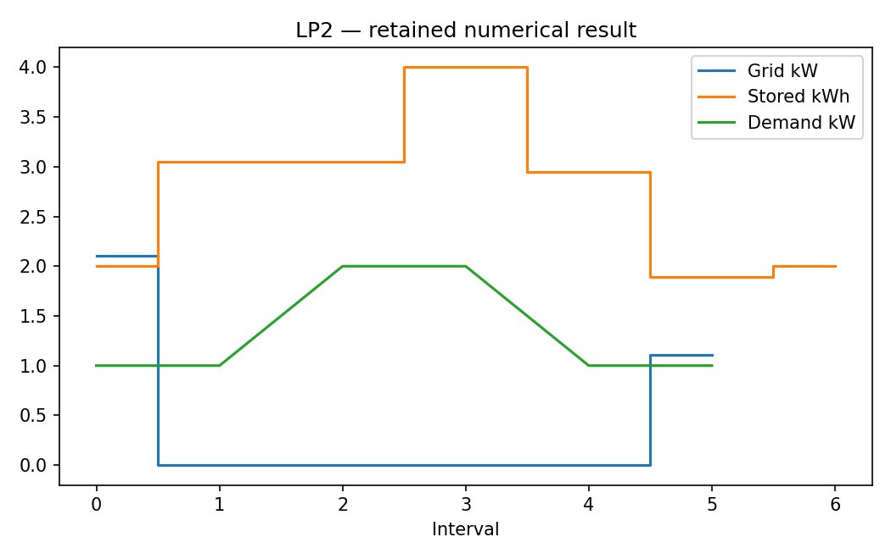

# LP2: Battery dispatch: time coupling and operating modes

This executable chapter uses the existing native Rust solver through its Python API. The numerical definitions live with this chapter's owner; the shared driver supplies orchestration and figures.

## Model and decision

Grid import plus solar minus curtailment plus discharge equals load plus charge. Stored energy follows e[t+1]=e[t]+eta_c*c[t]-d[t]/eta_d for one-hour intervals. Initial and final energy agree. The MIP adds c<=Cmax*z and d<=Dmax*(1-z), using physical limits rather than an arbitrary big-M.

## Work through the lesson

Each interval is one hour. Let $g,c,d,s,e$ denote grid import, charging, discharging, curtailed solar and stored energy. The rows are

$$g_t+PV_t-s_t+d_t=L_t+c_t,\qquad e_{t+1}=e_t+\eta c_t-d_t/\eta.$$

The final energy equals the initial energy, so an apparent saving cannot come from emptying the battery. The objective prices grid import plus any declared throughput charge.

1. Reproduce the ideal two-period cost 1, then change both conversion efficiencies to 0.9 and obtain 1.57. The round-trip efficiency is $\eta^2$.
2. Inspect the negative-price counterexample: simultaneous charging/discharging gives relaxed cost -0.19 while exclusive modes give 0. The binary rows $c_t\le Pz_t$, $d_t\le P(1-z_t)$ prohibit this loss-making physical loop that earns money in the price model.
3. Read `daily` alongside `no_battery`. Recompute every power and energy row from the stored arrays; compare like-for-like terminal energy and units.

## Run

Install the pinned solver distributions and scientific dependencies using the [shared setup](https://github.com/dietmarwo/optimization-jobs/blob/main/tutorials/structured/README.md). Keep the patched repositories as sibling directories. From this repository's root:

```bash
python ../optimization-jobs/tutorials/structured/run.py --chapter LP2 --output /absolute/new/lp2
```

For the owner entry point, run `python tutorials/battery-dispatch/run.py --preset smoke --output /absolute/new/lp2-direct`. It produces JSON; the shared driver additionally renders PNG/SVG figures. `--preset study` selects the declared larger cases. Output may be new or empty, and an occupied directory is refused.

## Independent answer and validation

Two-period prices (1,3) and demand (0,1) cost 1 with ideal efficiency, or 1.57 with efficiencies 0.9. A one-period negative-price LP cycles charge 1/discharge 0.81 to receive 0.19; the exclusive MIP costs zero. The six-hour smoke and 24-hour study include a no-battery baseline and frozen-schedule replay.

Every run retains native status, points and available diagnostics. LP candidates are checked against row/bound/integrality requirements; SQP results retain derivative checks and independently reconstructed KKT residuals. Application-specific references are computed separately. All failures remain in the report.

## Read the result

Read `summary.json` before interpreting `figure.png`. The report records the actual result; expected reference values are not substituted for missing numerical outcomes. A completed command job means that the chapter's executable checks completed, while individual solver attempts can still be nonconvergent where the lesson explicitly retains them.

The cycling counterexample exposes a formulation assumption, not a solver defect. Replay failures remain visible. The data and tariffs are synthetic; throughput cost is only a declared approximation.

## Agent prompt

> Schedule grid imports and battery charge/discharge for the frozen demand, solar and price series. Keep terminal stored energy equal to the initial value, state the units, and decide when simultaneous charging/discharging must be prohibited.

Use the complete [prompt](prompt.md) for the workflow and evidence requirements.

## Follow-up exercise

Replay with demand +15% and solar -25%. Change only grid/curtailment recourse. Compare this with a separately re-optimized perfect-foresight solution.

## Provenance and limits

The original plan's probes are historical planning evidence. The checked-in `results/smoke/summary.json` and figures record this implementation's executed case. Source and installed-package identities are also recorded by the shared driver. These are reproducible teaching experiments, not industrial or hardware performance certifications. Cross-formulation and cross-solver tables are descriptive.

## Recorded example



Inspect the [complete smoke summary](results/smoke/summary.json) alongside the figure.

The [study summary](results/study/summary.json) and [study figure](results/study/figure.png) retain the declared study preset separately.
