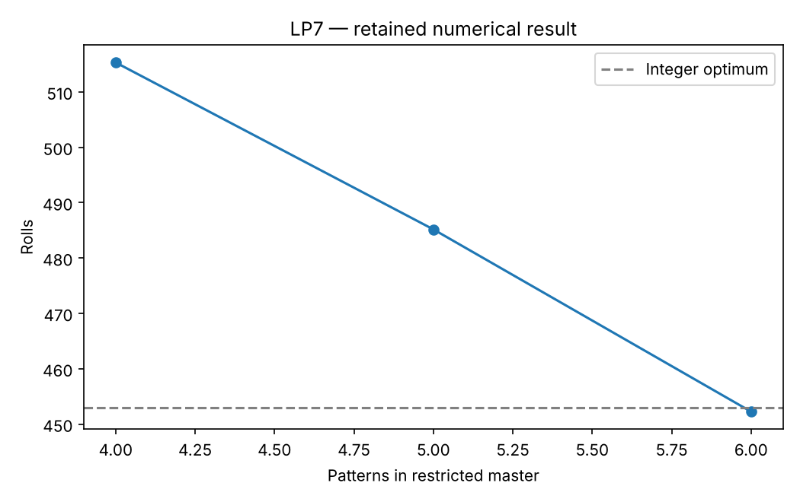

# LP7: Cutting stock and column generation

This chapter runs native Rust solvers through their Python APIs. Its model and independent checks live in this directory; the shared driver in optimization-jobs adds figures and command-job execution.

## Model and decision

Roll width is 100; required widths (45,36,31,14) have demands (97,610,395,211). Start with single-width patterns, solve a restricted master, and price another pattern using the returned duals.

## Work through the lesson

Standard rolls have width 100. Required widths are $(45,36,31,14)$ with demands $(97,610,395,211)$. A pattern $a$ is any nonnegative integer vector with $w^Ta\le100$.

$$\min\sum_ax_a,\qquad\sum_aa_ix_a\ge d_i.$$

1. Start with one uniform pattern per width and solve the restricted master LP. Its demand duals price the items.
2. Price a pattern by maximizing $y^Ta$. A value greater than 1 identifies a negative reduced-cost column. Keep every master and pricing result in `history`.
3. At termination, rationalize the solver's final duals, $(1/2,1/2,1/4,0)$, and verify them exactly. Exact dynamic programming over capacities 0…100 proves every possible pattern has price at most 1, independently of floating-point pricing.
4. The exact LP bound is $1809/4=452.25$. The feasible 453-roll integer plan meets its rounded lower bound, so the tutorial's own argument establishes integer optimality for the full pattern model.

## Run

Install the pinned solver packages and scientific dependencies as described in the [shared setup](https://github.com/dietmarwo/optimization-jobs/blob/main/tutorials/structured/README.md), with the repositories it lists cloned side by side. From this repository's root:

```bash
python ../optimization-jobs/tutorials/structured/run.py --chapter LP7 --output /absolute/new/lp7
```

To run the chapter on its own, use `python tutorials/cutting-stock/run.py --preset smoke --output /absolute/new/lp7-direct`. It produces JSON; the shared driver additionally renders PNG/SVG figures. `--preset study` runs the larger declared cases; a chapter without them repeats the smoke case. Output may be new or empty, and an occupied directory is refused.

## Independent answer and validation

The LP optimum is 452.25. The exact dual (1/2,1/2,1/4,0) has maximum pattern price 1, checked by rational dynamic programming and independent pattern enumeration. The generated integer master uses 453 rolls and attains the ceiling bound.

Every run keeps the native status, points and available diagnostics, and every LP candidate is checked against its rows, bounds and integrality independently of the solver. Application-specific references are computed separately. All failures remain in the report.

## Read the result

Read `summary.json` before interpreting `figure.png`. The report records the actual result; expected reference values are not substituted for missing numerical outcomes. A completed command job means that the chapter's executable checks completed, while individual solver attempts can still be nonconvergent where the lesson explicitly retains them.

Every master is a fresh LP solve; no public LP basis warm start is assumed. Exact pricing and the objective-lattice argument establish this particular integer optimum.

## Agent prompt

> Meet the frozen cutting-stock demand with as few standard rolls as possible. Generate useful patterns from LP dual prices, explain the pricing stopping test, and independently verify a bound that covers every possible pattern.

Use the complete [prompt](prompt.md) for the workflow and evidence requirements.

## Follow-up exercise

Change demand and compare rounding with the integer master. State why an integer master over a restricted column set is a heuristic in general.

## Provenance and limits

The checked-in `results/` record one run of each preset. The shared driver writes source and package identities to `environment.json` for the runs it makes. These are reproducible teaching experiments, not industrial or hardware performance certifications. Tables that compare formulations or solvers are descriptive.

## Recorded example



Inspect the [complete smoke summary](results/smoke/summary.json) alongside the figure.

The [study summary](results/study/summary.json) and [study figure](results/study/figure.png) record the study preset.
