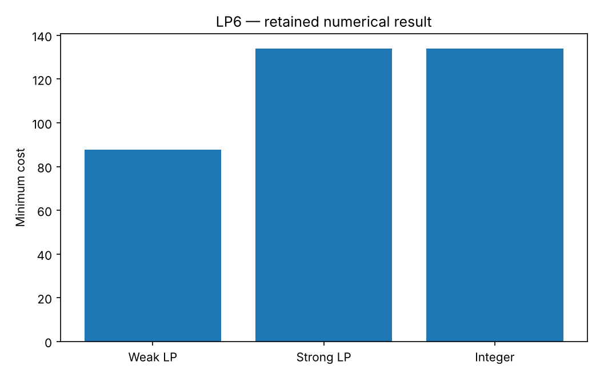

# LP6: Facility location: formulation strength

This chapter runs native Rust solvers through their Python APIs. Its model and independent checks live in this directory; the shared driver in optimization-jobs adds figures and command-job execution.

## Model and decision

Five sites and ten weighted customers use fixed opening costs plus Manhattan service costs. Compare aggregated linking sum_j x_ij <= 10 y_i with the disaggregated x_ij <= y_i. Both express the same integer choices.

## Work through the lesson

Open-site binaries $y_i$ and assignment fractions $x_{ij}$ satisfy $\sum_i x_{ij}=1$. Weighted Manhattan distance gives service costs; the fixed-opening costs and coordinates are frozen in the canonical model.

1. Compare the five aggregated links $\sum_jx_{ij}\le10y_i$ with the 50 disaggregated links $x_{ij}\le y_i$. For binary $y$ they describe the same feasible assignments. Fractional openings exploit the aggregated version.
2. Read native work and bounds, then independently enumerate all 31 nonempty sets of open sites. Both MIPs cost 134 and open sites 4 and 5; the weak LP gives 87.6 and the strong LP 134.
3. Add the declared capacities. Enumeration now solves a small transportation LP per open set because demand can split. The capacitated optimum is 143; strong links do not generally imply an integral relaxation.

## Run

Install the pinned solver packages and scientific dependencies as described in the [shared setup](https://github.com/dietmarwo/optimization-jobs/blob/main/tutorials/structured/README.md), with the repositories it lists cloned side by side. From this repository's root:

```bash
python ../optimization-jobs/tutorials/structured/run.py --chapter LP6 --output /absolute/new/lp6
```

To run the chapter on its own, use `python tutorials/facility-location/run.py --preset smoke --output /absolute/new/lp6-direct`. It produces JSON; the shared driver additionally renders PNG/SVG figures. `--preset study` runs the larger declared cases; a chapter without them repeats the smoke case. Output may be new or empty, and an occupied directory is refused.

## Independent answer and validation

Enumerating 31 nonempty open sets gives integer cost 134. The weak relaxation is 87.6, while the strong one is 134 for this instance. A capacitated follow-up enumerates open sets with an independent transport LP and checks the native MIP.

Every run keeps the native status, points and available diagnostics, and every LP candidate is checked against its rows, bounds and integrality independently of the solver. Application-specific references are computed separately. All failures remain in the report.

## Read the result

Read `summary.json` before interpreting `figure.png`. The report records the actual result; expected reference values are not substituted for missing numerical outcomes. A completed command job means that the chapter's executable checks completed, while individual solver attempts can still be nonconvergent where the lesson explicitly retains them.

Formulation comparisons are descriptive because the input models differ. A node-count difference on this fixture is not a general timing result.

## Agent prompt

> Choose which candidate depots to open. Solve the aggregated and disaggregated formulations, explain why their relaxed bounds differ, and verify their common integer answer by open-set enumeration. Check the capacitated variant separately.

Use the complete [prompt](prompt.md) for the workflow and evidence requirements.

## Follow-up exercise

Drop one linking row and construct a closed-site assignment that the domain checker should reject. Explain why the strong relaxation need not be integral after capacity constraints.

## Provenance and limits

The checked-in `results/` record one run of each preset. The shared driver writes source and package identities to `environment.json` for the runs it makes. These are reproducible teaching experiments, not industrial or hardware performance certifications. Tables that compare formulations or solvers are descriptive.

## Recorded example



Inspect the [complete smoke summary](results/smoke/summary.json) alongside the figure.

The [study summary](results/study/summary.json) and [study figure](results/study/figure.png) record the study preset.
