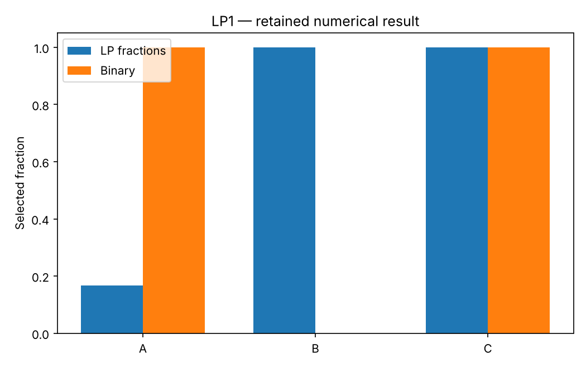

# LP1: Resource allocation: relaxation to integer decisions

This chapter runs native Rust solvers through their Python APIs. Its model and independent checks live in this directory; the shared driver in optimization-jobs adds figures and command-job execution.

## Model and decision

Maximize 9A+8B+7C subject to 6A+5B+4C <= budget, with binary selections. The relaxation changes only the domains to [0,1]. A second six-project case adds staffing, a prerequisite and an exclusion. Named coefficients are emitted through the same model builder used by the solver.

## Work through the lesson

Write the binary model before relaxing it:

$$\max 9A+8B+7C,\qquad 6A+5B+4C\le B_0,\quad A,B,C\in\{0,1\}.$$

1. At $B_0=10$, enumerate the eight selections. A+C costs 10 and earns 16. The relaxed point $(1/6,1,1)$ earns 16.5; it is an upper bound, not a selection.
2. Set $B_0=9$. B+C now wins with 15, and the relaxation happens to be integral. That observation does not make every allocation LP integral.
3. Inspect `cases` for the native bound, incumbent, work and greedy start; inspect `extended` for the extra resource, prerequisite and exclusion rows. The one-row fractional-knapsack reference cannot certify that extended model.
4. For the forced-all case, distinguish the native numerical infeasibility report from the independent contradiction that cost 15 exceeds budget 9.

## Run

Install the pinned solver packages and scientific dependencies as described in the [shared setup](https://github.com/dietmarwo/optimization-jobs/blob/main/tutorials/structured/README.md), with the repositories it lists cloned side by side. From this repository's root:

```bash
python ../optimization-jobs/tutorials/structured/run.py --chapter LP1 --output /absolute/new/lp1
```

To run the chapter on its own, use `python tutorials/resource-allocation/run.py --preset smoke --output /absolute/new/lp1-direct`. It produces JSON; the shared driver additionally renders PNG/SVG figures. `--preset study` runs the larger declared cases; a chapter without them repeats the smoke case. Output may be new or empty, and an occupied directory is refused.

## Independent answer and validation

At budget 10 the LP value is 16.5 and A+C gives integer value 16. At budget 9, B+C gives 15 and the relaxation is integral. All eight assignments are enumerated independently. The six-project optimum is 16. The script also runs a greedy MIP start and a forced-all infeasibility case.

Every run keeps the native status, points and available diagnostics, and every LP candidate is checked against its rows, bounds and integrality independently of the solver. Application-specific references are computed separately. All failures remain in the report.

## Read the result

Read `summary.json` before interpreting `figure.png`. The report records the actual result; expected reference values are not substituted for missing numerical outcomes. A completed command job means that the chapter's executable checks completed, while individual solver attempts can still be nonconvergent where the lesson explicitly retains them.

For maximization an incumbent is a lower bound; the relaxation is an upper bound. A fractional point is not a feasible binary selection. The independent cost contradiction is separate from native numerical infeasibility.

## Agent prompt

> Choose projects under the frozen budget and staffing limits. Compare the integer decision with its relaxation, explain the bound direction, and show why the prerequisite/exclusion case needs its own reference.

Use the complete [prompt](prompt.md) for the workflow and evidence requirements.

## Follow-up exercise

Change budget 10 to 9; predict the answer first. Add C <= B and explain why the one-row fractional-knapsack oracle must be replaced for the new model.

## Provenance and limits

The checked-in `results/` record one run of each preset. The shared driver writes source and package identities to `environment.json` for the runs it makes. These are reproducible teaching experiments, not industrial or hardware performance certifications. Tables that compare formulations or solvers are descriptive.

## Recorded example



Inspect the [complete smoke summary](results/smoke/summary.json) alongside the figure.

The [study summary](results/study/summary.json) and [study figure](results/study/figure.png) record the study preset.
