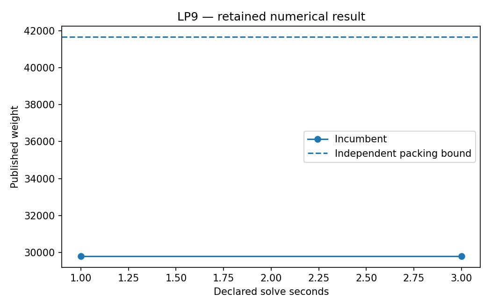

# LP9: SpOC4 matching: incumbent quality at a budget

This executable chapter uses the existing native Rust solver through its Python API. The numerical definitions live with this chapter's owner; the shared driver supplies orchestration and figures.

## Model and decision

Reuse the existing ESA matching parser, original resource identifiers, greedy seed and native set-packing adapter. Smoke uses the complete 25,000-edge matching-I table; study uses matching-II. Data stays in its original GPL-3.0 directory.

## Work through the lesson

The smoke preset uses all 25,000 matching-I edges from the existing competition fixture. Each selected edge consumes one resource from each of three partitions. The integer objective is published weight, with exact thousandths retained for auditing.

1. Inspect the input checksum and existing data-source/license record. The chapter reuses the maintained benchmark adapter and checker; it does not copy the competition data into a new dataset.
2. Compare the declared one- and three-second smoke limits. The retained incumbent is 29,791.692. Both native runs end at a time limit and return no native bound; those fields remain null.
3. A separately checked dyadic packing certificate gives upper bound 41,661.853 on matching-I. Label it as independent evidence, not a bound returned by the native search. The gap is intentionally substantial.
4. Study selects matching-II with a larger budget. This is the SpOC matching application; it does not fill the ecosystem's still-unfilled GTOC target card.

## Run

Install the pinned solver distributions and scientific dependencies using the [shared setup](https://github.com/dietmarwo/optimization-jobs/blob/main/tutorials/structured/README.md). Keep the patched repositories as sibling directories. From this repository's root:

```bash
python ../optimization-jobs/tutorials/structured/run.py --chapter LP9 --output /absolute/new/lp9
```

For the owner entry point, run `python tutorials/spoc4-matching/run.py --preset smoke --output /absolute/new/lp9-direct`. It produces JSON; the shared driver additionally renders PNG/SVG figures. `--preset study` selects the declared larger cases. Output may be new or empty, and an occupied directory is refused.

## Independent answer and validation

Each candidate is checked against original resource triples and integer thousandths of the weight. Runs retain time/node/pivot information. When the native bound is unavailable, an independent dyadic packing bound is computed using the existing certificate helper.

Every run retains native status, points and available diagnostics. LP candidates are checked against row/bound/integrality requirements; SQP results retain derivative checks and independently reconstructed KKT residuals. Application-specific references are computed separately. All failures remain in the report.

## Read the result

Read `summary.json` before interpreting `figure.png`. The report records the actual result; expected reference values are not substituted for missing numerical outcomes. A completed command job means that the chapter's executable checks completed, while individual solver attempts can still be nonconvergent where the lesson explicitly retains them.

A time limit with a feasible incumbent is useful evidence. An unavailable native bound remains null. These tables do not fill the separate GTOC target card.

## Agent prompt

> Run the full SpOC4 matching fixture under its declared work budgets. Audit the incumbent, explain what missing native bounds mean, and distinguish an independent resource-packing bound from a native search claim.

Use the complete [prompt](prompt.md) for the workflow and evidence requirements.

## Follow-up exercise

Increase the declared budget and compare retained incumbents. Convert an MPS model using the existing converter, keeping that exercise distinct from the matching formulation.

## Provenance and limits

The original plan's probes are historical planning evidence. The checked-in `results/smoke/summary.json` and figures record this implementation's executed case. Source and installed-package identities are also recorded by the shared driver. These are reproducible teaching experiments, not industrial or hardware performance certifications. Cross-formulation and cross-solver tables are descriptive.

## Recorded example



Inspect the [complete smoke summary](results/smoke/summary.json) alongside the figure.

The [study summary](results/study/summary.json) and [study figure](results/study/figure.png) retain the declared study preset separately.
