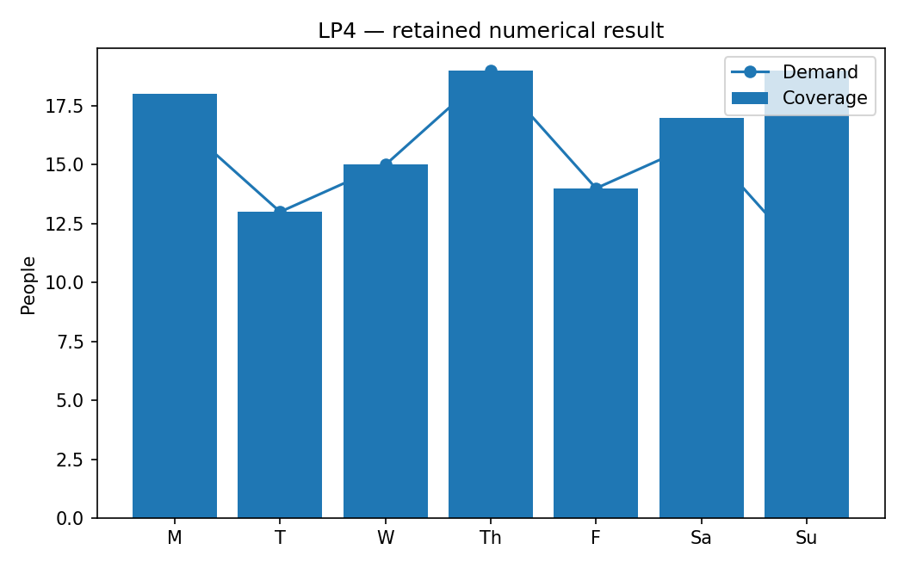

# LP4: Staff rostering and an exact lower bound

This executable chapter uses the existing native Rust solver through its Python API. The numerical definitions live with this chapter's owner; the shared driver supplies orchestration and figures.

## Model and decision

Seven integer variables count people starting on each weekday. Every person works five consecutive cyclic days. Minimize headcount while covering demand (17,13,15,19,14,16,11), with each pattern bounded by the maximum demand 19.

## Work through the lesson

Let $x_j$ be the number of workers whose five consecutive working days start on day $j$. The seven columns wrap around the week. Daily demands are $(17,13,15,19,14,16,11)$.

$$\min\sum_jx_j,\qquad Ax\ge d,\qquad x\ge0.$$

1. Solve the relaxation, then check $y=(1/3,0,1/3,1/3,0,1/3,0)$ exactly: $y\ge0$, $A^Ty\le1$ and $d^Ty=67/3$.
2. Any integer headcount is at least $\lceil67/3\rceil=23$. The feasible 23-worker roster therefore proves this teaching instance optimal by a separate rational argument.
3. Fix headcount to 23 before minimizing weekend coverage in `lexicographic`. A weighted single objective could trade workers against weekends and would be a different preference model.

## Run

Install the pinned solver distributions and scientific dependencies using the [shared setup](https://github.com/dietmarwo/optimization-jobs/blob/main/tutorials/structured/README.md). Keep the patched repositories as sibling directories. From this repository's root:

```bash
python ../optimization-jobs/tutorials/structured/run.py --chapter LP4 --output /absolute/new/lp4
```

For the owner entry point, run `python tutorials/staff-rostering/run.py --preset smoke --output /absolute/new/lp4-direct`. It produces JSON; the shared driver additionally renders PNG/SVG figures. `--preset study` selects the declared larger cases. Output may be new or empty, and an occupied directory is refused.

## Independent answer and validation

An exactly checked dual with weights 1/3 on Monday, Wednesday, Thursday and Saturday gives 67/3. Integer headcount is therefore at least 23. The native MIP finds 23; a second solve fixes that headcount and minimizes weekend coverage.

Every run retains native status, points and available diagnostics. LP candidates are checked against row/bound/integrality requirements; SQP results retain derivative checks and independently reconstructed KKT residuals. Application-specific references are computed separately. All failures remain in the report.

## Read the result

Read `summary.json` before interpreting `figure.png`. The report records the actual result; expected reference values are not substituted for missing numerical outcomes. A completed command job means that the chapter's executable checks completed, while individual solver attempts can still be nonconvergent where the lesson explicitly retains them.

Different rosters can be equally optimal. The exact rational argument belongs to this teaching case and does not change the native solver's evidence level.

## Agent prompt

> Find the smallest five-days-on roster for the supplied weekly demand. Give a separate argument that one fewer worker is impossible, then minimize weekend coverage while retaining the minimum headcount.

Use the complete [prompt](prompt.md) for the workflow and evidence requirements.

## Follow-up exercise

Add a part-time pattern costing 0.6. Explain why rounding an objective bound to the next integer is then invalid unless a new objective lattice is justified.

## Provenance and limits

The original plan's probes are historical planning evidence. The checked-in `results/smoke/summary.json` and figures record this implementation's executed case. Source and installed-package identities are also recorded by the shared driver. These are reproducible teaching experiments, not industrial or hardware performance certifications. Cross-formulation and cross-solver tables are descriptive.

## Recorded example



Inspect the [complete smoke summary](results/smoke/summary.json) alongside the figure.

The [study summary](results/study/summary.json) and [study figure](results/study/figure.png) retain the declared study preset separately.
