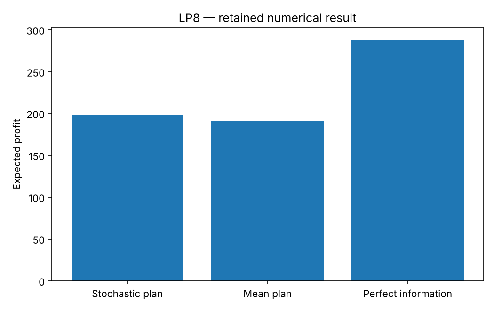

# LP8: Two-stage planning under uncertainty

This chapter runs native Rust solvers through their Python APIs. Its model and independent checks live in this directory; the shared driver in optimization-jobs adds figures and command-job execution.

## Model and decision

A newsvendor buys before demand is known. Unit purchase cost is 4, sale price 10 and salvage 1. Demand (20,40,60,80,100) has probabilities (0.3,0.3,0.2,0.1,0.1). A second application shares initial capacity across two products and buys costly recourse after demand is observed.

## Work through the lesson

Order $q$ units before demand is known. Purchase costs 4, sales earn 10 and leftovers recover 1. Demand $(20,40,60,80,100)$ has probabilities $(0.3,0.3,0.2,0.1,0.1)$.

1. Use the critical fractile $(10-4)/(10-1)=2/3$ to predict $q=60$, then solve the deterministic-equivalent LP. Expected profit is 198.
2. Evaluate the mean-demand decision $q=48$ in the original scenarios: it earns 190.8. The value of the stochastic solution is 7.2. Optimizing after observing each scenario earns 288, so perfect information is worth 90.
3. In `two_product`, first-stage orders share capacity 80; expensive emergency purchases supply recourse. Training samples use seed 42; a separate seed 314159 supplies the 128-case holdout. Study sizes 8, 16 and 32 describe sample sensitivity, not a statistical performance proof.

## Run

Install the pinned solver packages and scientific dependencies as described in the [shared setup](https://github.com/dietmarwo/optimization-jobs/blob/main/tutorials/structured/README.md), with the repositories it lists cloned side by side. From this repository's root:

```bash
python ../optimization-jobs/tutorials/structured/run.py --chapter LP8 --output /absolute/new/lp8
```

To run the chapter on its own, use `python tutorials/stochastic-planning/run.py --preset smoke --output /absolute/new/lp8-direct`. It produces JSON; the shared driver additionally renders PNG/SVG figures. `--preset study` runs the larger declared cases; a chapter without them repeats the smoke case. Output may be new or empty, and an occupied directory is refused.

## Independent answer and validation

The critical ratio is 2/3; order 60 yields expected profit 198. Ordering mean demand 48 yields 190.8. Perfect-information profit is 288, so VSS=7.2 and EVPI=90. The two-product model uses fixed training and disjoint holdout seeds; study runs use 8,16,32 scenarios.

Every run keeps the native status, points and available diagnostics, and every LP candidate is checked against its rows, bounds and integrality independently of the solver. Application-specific references are computed separately. All failures remain in the report.

## Read the result

Read `summary.json` before interpreting `figure.png`. The report records the actual result; expected reference values are not substituted for missing numerical outcomes. A completed command job means that the chapter's executable checks completed, while individual solver attempts can still be nonconvergent where the lesson explicitly retains them.

A sampled-scenario experiment is descriptive and retains its actual scenario set. Holdout data is not used to choose the training solution.

## Agent prompt

> Choose an order before demand is known, with recourse after observation. Compare the stochastic decision, the mean-demand decision and perfect information. Evaluate the two-product plan on its disjoint held-out scenarios.

Use the complete [prompt](prompt.md) for the workflow and evidence requirements.

## Follow-up exercise

Explain why the wait-and-see solution is not a realizable first-stage plan. Inspect holdout profit as the scenario sample changes.

## Provenance and limits

The checked-in `results/` record one run of each preset. The shared driver writes source and package identities to `environment.json` for the runs it makes. These are reproducible teaching experiments, not industrial or hardware performance certifications. Tables that compare formulations or solvers are descriptive.

## Recorded example



Inspect the [complete smoke summary](results/smoke/summary.json) alongside the figure.

The [study summary](results/study/summary.json) and [study figure](results/study/figure.png) record the study preset.
