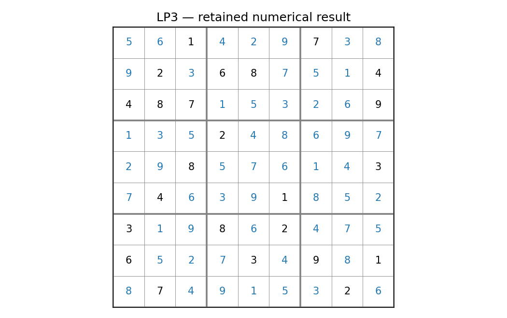

# LP3: Sudoku: feasibility and uniqueness

This executable chapter uses the existing native Rust solver through its Python API. The numerical definitions live with this chapter's owner; the shared driver supplies orchestration and figures.

## Model and decision

One binary per row, column and digit, with cell, row-digit, column-digit and box-digit equalities. Clues fix selected variables. A no-good row sums the solved values of free cells and excludes exactly one completed grid.

## Work through the lesson

A binary $x_{rcv}$ says that cell $(r,c)$ contains value $v$. Every cell, row/value, column/value and block/value group sums to one; clues fix selected binaries. The objective is zero: this is feasibility.

1. Inspect the 9×9 solution and check all four families directly. Black digits in the figure are clues; blue digits are filled cells.
2. Exclude its 81 selected binaries with $\sum_{(r,c,v)\in S}x_{rcv}\le80$ and solve again. Infeasibility of that model is the native uniqueness claim; an independent backtracking count supplies separate evidence.
3. Enumerate all 288 complete 4×4 Shidoku grids. Generated partial grids with one and two completions test the counter and encoding without relying on a solver's presolve behavior.
4. Compare the retained 9×9 unique and two-solution variants. A found completion alone says nothing about uniqueness.

## Run

Install the pinned solver distributions and scientific dependencies using the [shared setup](https://github.com/dietmarwo/optimization-jobs/blob/main/tutorials/structured/README.md). Keep the patched repositories as sibling directories. From this repository's root:

```bash
python ../optimization-jobs/tutorials/structured/run.py --chapter LP3 --output /absolute/new/lp3
```

For the owner entry point, run `python tutorials/sudoku/run.py --preset smoke --output /absolute/new/lp3-direct`. It produces JSON; the shared driver additionally renders PNG/SVG figures. `--preset study` selects the declared larger cases. Output may be new or empty, and an occupied directory is refused.

## Independent answer and validation

The independent counter enumerates 288 complete 4x4 grids, freezes a unique and a two-solution tiny puzzle, and counts the checked-in 9x9 case. Removing row 5 column 3 creates two solutions. The native solver finds the first and the no-good model tests the second.

Every run retains native status, points and available diagnostics. LP candidates are checked against row/bound/integrality requirements; SQP results retain derivative checks and independently reconstructed KKT residuals. Application-specific references are computed separately. All failures remain in the report.

## Read the result

Read `summary.json` before interpreting `figure.png`. The report records the actual result; expected reference values are not substituted for missing numerical outcomes. A completed command job means that the chapter's executable checks completed, while individual solver attempts can still be nonconvergent where the lesson explicitly retains them.

Uniqueness rests on the independent finite counter. Numerical infeasibility after the cut remains the solver's own claim. This is a feasibility model; a zero objective does not rank completed grids.

## Agent prompt

> Solve the supplied Sudoku and tell me whether it has exactly one completion. Explain the no-good cut, check it with a separate counter, and distinguish finding a solution from showing uniqueness.

Use the complete [prompt](prompt.md) for the workflow and evidence requirements.

## Follow-up exercise

Remove the designated clue. Deliberately use an all-cells no-good sum with a free-cell right-hand side and explain why it could fake uniqueness.

## Provenance and limits

The original plan's probes are historical planning evidence. The checked-in `results/smoke/summary.json` and figures record this implementation's executed case. Source and installed-package identities are also recorded by the shared driver. These are reproducible teaching experiments, not industrial or hardware performance certifications. Cross-formulation and cross-solver tables are descriptive.

## Recorded example



Inspect the [complete smoke summary](results/smoke/summary.json) alongside the figure.

The [study summary](results/study/summary.json) and [study figure](results/study/figure.png) retain the declared study preset separately.
