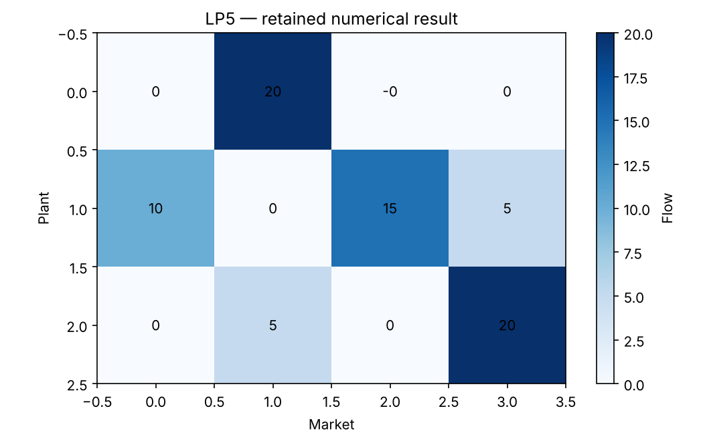

# LP5: Transportation, integrality and marginal prices

This chapter runs native Rust solvers through their Python APIs. Its model and independent checks live in this directory; the shared driver in optimization-jobs adds figures and command-job execution.

## Model and decision

Three plants supply (20,30,25) and four markets demand (10,25,15,25). Costs are [[8,6,10,9],[9,12,13,7],[14,9,16,5]]. The network LP has integer vertices. A shared-carrier row limits P1-M2 plus P3-M4 to 9.

## Work through the lesson

The supply vector is $(20,30,25)$ and demand is $(10,25,15,25)$. The 3×4 route-cost table is retained as `costs`. Supply rows are capacities; demand rows require delivery.

1. Recompute the 585-cost base flow route by route. Its network structure permits integral extreme points even with continuous variables.
2. Inspect the solver's duals (`native_duals`), the binary64-safe bound they give (`safe_dual_bound`, 585) and `whatif`. The balanced model has one redundant row, so the price level is arbitrary; only differences are meaningful. Extra supply at plant 3 saves 2 per unit for the first five units; the next unit crosses a basis change. A dual predicts a local change for a specified perturbation, not an unlimited discount.
3. Add the shared-carrier side row. The LP costs 617 and the integer model 619: the side constraint changes the structure, so the former integrality argument no longer applies.
4. The separate assignment fixture has value 13. The native LP relaxation returns an integral vertex, and both permutation enumeration and the Hungarian method confirm the value.

## Run

Install the pinned solver packages and scientific dependencies as described in the [shared setup](https://github.com/dietmarwo/optimization-jobs/blob/main/tutorials/structured/README.md), with the repositories it lists cloned side by side. From this repository's root:

```bash
python ../optimization-jobs/tutorials/structured/run.py --chapter LP5 --output /absolute/new/lp5
```

To run the chapter on its own, use `python tutorials/transportation-duals/run.py --preset smoke --output /absolute/new/lp5-direct`. It produces JSON; the shared driver additionally renders PNG/SVG figures. `--preset study` runs the larger declared cases; a chapter without them repeats the smoke case. Output may be new or empty, and an occupied directory is refused.

## Independent answer and validation

Base cost is 585, with an exact dual certificate. The carrier LP gives 617 and its integer model 619. Increasing plant 3 capacity saves 2 per unit for the first five units, then zero. A separate assignment example costs 13 by both permutation enumeration and the Hungarian method.

Every run keeps the native status, points and available diagnostics, and every LP candidate is checked against its rows, bounds and integrality independently of the solver. Application-specific references are computed separately. All failures remain in the report.

## Read the result

Read `summary.json` before interpreting `figure.png`. The report records the actual result; expected reference values are not substituted for missing numerical outcomes. A completed command job means that the chapter's executable checks completed, while individual solver attempts can still be nonconvergent where the lesson explicitly retains them.

The carrier row breaks the network integrality guarantee. Dual arrays are accessed through the Python API; the existing stock worker exports residuals rather than those arrays.

## Agent prompt

> Plan shipments from the supplied plants to markets at minimum cost. Price one extra unit of plant capacity and verify the range over which that price predicts the saving. Add the shared-carrier row and explain the integrality change.

Use the complete [prompt](prompt.md) for the workflow and evidence requirements.

## Follow-up exercise

Predict the sixth additional unit's value before solving. Inspect how balanced-row dual prices can shift while their meaningful combinations stay unchanged.

## Provenance and limits

The checked-in `results/` record one run of each preset. The shared driver writes source and package identities to `environment.json` for the runs it makes. These are reproducible teaching experiments, not industrial or hardware performance certifications. Tables that compare formulations or solvers are descriptive.

## Recorded example



Inspect the [complete smoke summary](results/smoke/summary.json) alongside the figure.

The [study summary](results/study/summary.json) and [study figure](results/study/figure.png) record the study preset.
